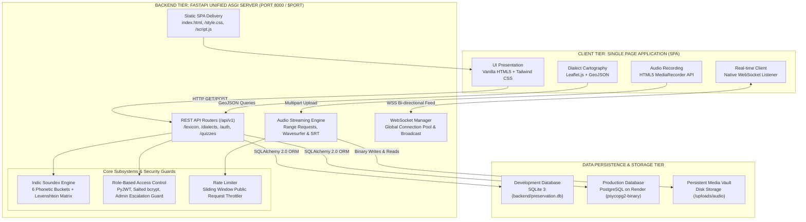
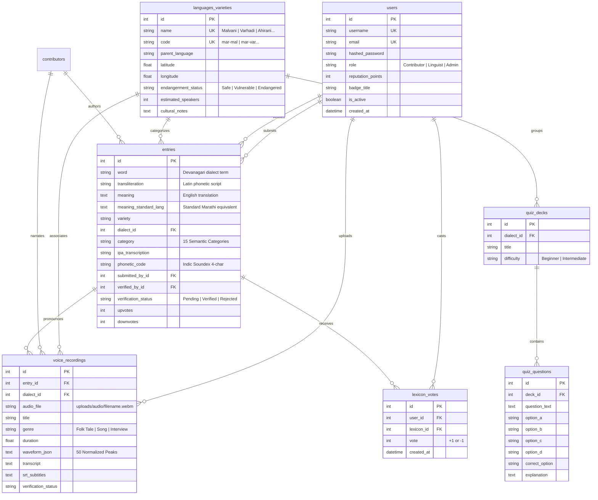
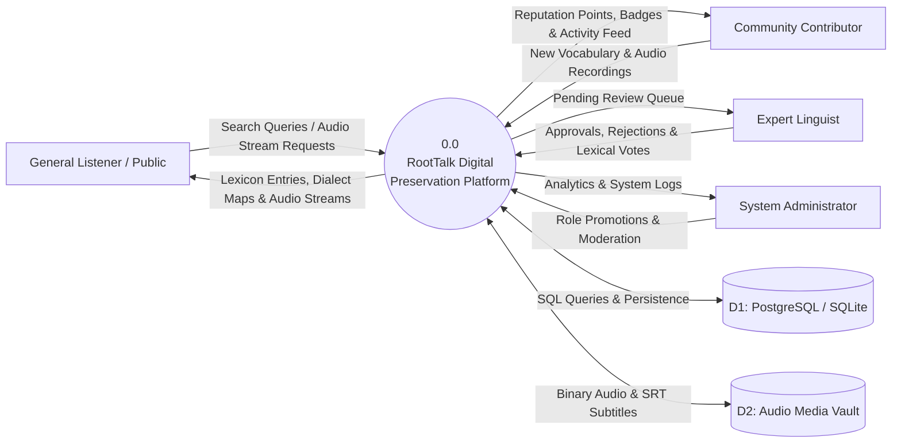
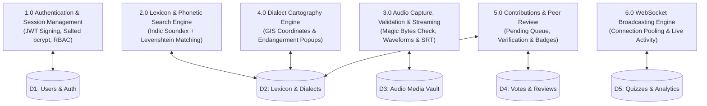
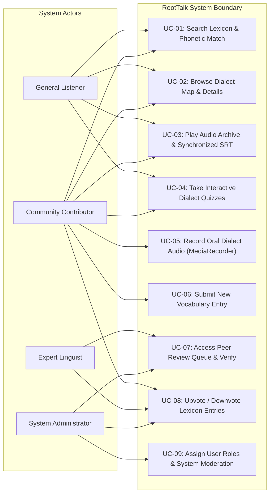

# RootTalk: Digital Preservation of Regional Languages & Dialects
## Final Year Capstone Project Report (Black Book)
**Degree:** Bachelor of Science in Computer Science / Information Technology  
**Academic Year:** 2025 – 2026  
**Repository:** [d:\cPROJECT\RootTalk](file:///d:/cPROJECT/RootTalk)  
**Deliverable File:** `RootTalk_Final_Project_Report.docx` (A4 College Black Book Format)

---

## Preliminary Pages Summary

### 1. Cover Page / Title Header
- **Institution:** `[COLLEGE / INSTITUTION NAME PLACEHOLDER]`
- **Affiliated University:** `[AFFILIATED UNIVERSITY NAME PLACEHOLDER]`
- **Project Title:** RootTalk: Digital Preservation of Regional Languages & Dialects
- **Subtitle:** An Interactive Full-Stack Linguistic Platform with Indic Phonetic Search, Audio Waveform Archiving & Real-Time Collaborative WebSockets
- **Project Team:**
  1. **Aaditya Jadhav** — Project Lead & Dialect Preserver (`[ROLL_NO_PLACEHOLDER_1]`)
  2. **Padmaj Jadhav** — Linguistics Researcher (`[ROLL_NO_PLACEHOLDER_2]`)
  3. **Parth Kadam** — Technical Developer (`[ROLL_NO_PLACEHOLDER_3]`)
- **Project Guide:** `[GUIDE_NAME_PLACEHOLDER]`, `[GUIDE_DESIGNATION_PLACEHOLDER]`
- **Department:** Department of Computer Science & Information Technology

---

### 2. Certificate of Authenticity (Official College Format)
> This is to certify that the project report entitled **"RootTalk: Digital Preservation of Regional Languages & Dialects"** is a bonafide record of the authentic capstone engineering work carried out by **Aaditya Jadhav**, **Padmaj Jadhav**, and **Parth Kadam** in partial fulfillment of the requirements for the award of Bachelor of Science in Computer Science / Information Technology during the academic year 2025–2026.
> 
> *Signatures:*  
> • Project Guide: `[GUIDE_NAME_PLACEHOLDER]`  
> • Head of Department: `[HOD_NAME_PLACEHOLDER]`  
> • College Principal: `[PRINCIPAL_NAME_PLACEHOLDER]`  
> • Internal & External University Examiners: `[SIGNATURE_PLACEHOLDERS]`

---

### 3. Candidates' Declaration & Acknowledgement
The project team affirms that RootTalk represents original full-stack engineering and linguistic research. Acknowledgements are extended to the project mentor, departmental faculty, and native Marathi dialect speakers across Konkan, Vidarbha, Khandesh, and Marathwada who provided authentic oral vocabulary recordings.

---

### 4. Abstract
Indigenous regional languages represent irreplaceable repositories of cultural identity and ecological wisdom. In Maharashtra, vibrant varieties including Malvani, Varhadi, Ahirani, Agri, Koli, and Marathwadi face acute endangerment due to urban migration, educational centralization, and the total lack of Indic-aware digital tooling. 

RootTalk addresses this socio-technical challenge through a unified, single-service web platform combining an asynchronous Python FastAPI ASGI engine, an interactive Single-Page Application (HTML5, Tailwind CSS, Leaflet.js), an Indic Soundex + Levenshtein phonetic fuzzy search engine, an in-browser HTML5 MediaRecorder audio vault with binary magic byte validation and SRT subtitling, and real-time WebSocket activity broadcasting. The live system preserves 155 comprehensive lexical entries across 15 semantic categories and 7 regional varieties, supported by 9 authentic audio archives and 26 verified automated unit and integration tests.

---

## Formal Architectural Diagrams

### 1. System Architecture Diagram

---

### 2. Entity-Relationship Diagram (ERD)

---

### 3. Data Flow Diagrams (Level 0 Context & Level 1 Decomposition)

#### Level 0 Context Diagram

#### Level 1 Decomposition Diagram

---

### 4. System Use Case Diagram

---

## Empirical Test Execution Results (Pytest Suite)
**Test Execution Environment:** Python 3.12.10, Pytest 9.1.1, AnyIO 4.15.1, Isolated Test Database  
**Total Tests:** 26 Passed | **Warnings:** 1 (Starlette deprecation) | **Runtime:** 27.89 seconds  

| Test ID | Test Function Name | Functional Subsystem Tested | Method & Endpoint | Status |
| :--- | :--- | :--- | :--- | :--- |
| **TEST-01** | `test_root_endpoint` | API Root Health & Metadata | `GET /api/v1` | **PASSED** |
| **TEST-02** | `test_frontend_homepage_and_assets` | Unified Single-Service Static Serving | `GET /, /style.css, /script.js` | **PASSED** |
| **TEST-03** | `test_auth_login_and_me` | JWT Token Generation & User Context | `POST /api/v1/auth/login` | **PASSED** |
| **TEST-04** | `test_auth_admin_and_invalid_password`| Authentication Failure Handling | `POST /api/v1/auth/login` | **PASSED** |
| **TEST-05** | `test_jwt_expired_and_invalid_tokens` | RFC 7519 Cryptographic Verification | `GET /api/v1/auth/me` | **PASSED** |
| **TEST-06** | `test_role_escalation_prevention` | Public Registration Role Enforcement | `POST /api/v1/auth/register` | **PASSED** |
| **TEST-07** | `test_admin_promotes_user_role` | Administrative Role Assignment | `PUT /api/v1/auth/users/{id}/role`| **PASSED** |
| **TEST-08** | `test_password_handling_bcrypt_limit` | Bcrypt 72-Byte Boundary Safety Guard | `POST /api/v1/auth/login` | **PASSED** |
| **TEST-09** | `test_voting_requires_auth_and_updates`| Community Lexicon Upvoting Counter | `POST /api/v1/lexicon/{id}/vote` | **PASSED** |
| **TEST-10** | `test_audio_content_validation_and_size`| Binary Magic Byte & 25MB Size Check | `POST /api/v1/audio-archive/upload`| **PASSED** |
| **TEST-11** | `test_audio_stream_missing_and_existing`| Range Audio Streaming & 404 Check | `GET /api/v1/audio-archive/{id}/stream`| **PASSED** |
| **TEST-12** | `test_public_rate_limiting` | In-Memory Sliding Window Rate Limiting | `POST /api/v1/audio-archive/upload`| **PASSED** |
| **TEST-13** | `test_websocket_activity_event_delivery`| Asynchronous WebSocket Event Broadcast| `WSS /api/v1/ws/activity` | **PASSED** |
| **TEST-14** | `test_production_security_and_database` | PostgreSQL Driver Normalization Fix | Settings & DB URL Normalizer | **PASSED** |
| **TEST-15** | `test_list_dialects` | Dialect Registry & Speaker Metadata | `GET /api/v1/dialects/` | **PASSED** |
| **TEST-16** | `test_dialect_map_data` | Leaflet GeoJSON Cartography Endpoints | `GET /api/v1/dialects/map/data` | **PASSED** |
| **TEST-17** | `test_lexicon_and_ipa_generation` | Devanagari to IPA Translation Vault | `GET /api/v1/lexicon/` | **PASSED** |
| **TEST-18** | `test_lexicon_pagination_headers` | Pagination Limits & X-Total-Count Header| `GET /api/v1/lexicon/?limit=5` | **PASSED** |
| **TEST-19** | `test_phonetic_search` | Indic Soundex & Levenshtein Matrix | `GET /api/v1/lexicon/phonetic-search`| **PASSED** |
| **TEST-20** | `test_public_contribution_and_peer` | Peer Review Queue & Approvals | `POST /api/v1/contributions/verify` | **PASSED** |
| **TEST-21** | `test_audio_archive_and_subtitles` | SRT & WebVTT Subtitle Generation | `GET /api/v1/audio-archive/{id}/subtitles.srt`| **PASSED** |
| **TEST-22** | `test_quizzes` | Multiple-Choice Quiz Evaluation Engine | `POST /api/v1/quizzes/submit` | **PASSED** |
| **TEST-23** | `test_analytics_and_export` | Preservation Metrics & CSV/JSON Export| `GET /api/v1/analytics/export` | **PASSED** |
| **TEST-24** | `test_categories_and_contributors` | Category Taxonomy & Contributor API | `GET /api/categories, /contributors` | **PASSED** |
| **TEST-25** | `test_todays_word_retrieval` | Daily Featured Word Rotation Algorithm | `GET /api/entries/today` | **PASSED** |
| **TEST-26** | `test_dev_database_isolation` | Zero Contamination of Dev Database | Database Assertion (`preservation.db`)| **PASSED** |

---

## Live Database Statistics (Empirical Evidence)
- **Total Registered Users:** 5 users (`admin`, `dr_patil` [Linguist], `dr_chitnis` [Linguist], `konkan_preserver`, `parth_kadam`)
- **Total Dialect Varieties:** 7 documented varieties:
  - Malvani (14 words, 1.8M speakers, Vulnerable)
  - Varhadi (13 words, 12M speakers, Vulnerable)
  - Ahirani (7 words, 3M speakers, Definitely Endangered)
  - Agri (1 word, 1.5M speakers, Vulnerable)
  - Koli (1 word, 800K speakers, Vulnerable)
  - Marathwadi (7 words, 7.5M speakers, Vulnerable)
  - Standard Marathi (112 words, 83M speakers, Safe)
- **Total Dictionary Vocabulary:** 155 entries across 15 semantic categories
- **Semantic Categories:** Agriculture (10), Animals (10), Clothing (10), Daily Life (13), Emotions (10), Family (11), Food (10), Household (10), Idioms (10), Nature (10), Phrases (10), Places (10), Proverbs (10), Traditional Culture (11), Work (10)
- **Authentic Audio Recordings:** 9 verified recordings with waveforms, transcripts, and SRT subtitles
- **Interactive Quiz Decks:** 3 Decks (Malvani Vocabulary Challenge, Varhadi Expressions, Ahirani Heritage) with 5 multiple-choice questions

---

## Render Cloud Deployment Status
- **Architecture:** Single-Service Unified Web Service running FastAPI ASGI and serving SPA static files.
- **Port & Host Resolution:** Dynamically binds to `0.0.0.0:$PORT` via `backend/run_server.py`.
- **Database Driver Normalization:** Render `postgres://` connection string is normalized to `postgresql+psycopg2://` in `backend/app/config.py` and `database.py`, resolving the `ModuleNotFoundError: No module named 'psycopg'` issue.
- **Current Status:** **Staging Verification / In Progress** (all code and configuration fixes completed and verified locally).

---

## Missing Information Requiring User Input
The following institutional details are marked with clear bracketed placeholders in `RootTalk_Final_Project_Report.docx`:
1. `[ COLLEGE / INSTITUTION NAME PLACEHOLDER ]` (e.g., K.J. Somaiya College of Science & Commerce / Mithibai College)
2. `[ AFFILIATED UNIVERSITY NAME PLACEHOLDER ]` (e.g., University of Mumbai)
3. `[ COLLEGE LOGO / EMBLEM EMBED PLACEHOLDER ]` (Insert college emblem image on Cover Page)
4. `[ GUIDE_NAME_PLACEHOLDER ]` & `[ GUIDE_DESIGNATION_PLACEHOLDER ]` (e.g., Dr. Rajesh Sharma, Associate Professor)
5. `[ HOD_NAME_PLACEHOLDER ]` (Head of Department of Computer Science / IT)
6. `[ PRINCIPAL_NAME_PLACEHOLDER ]` (College Principal / Director)
7. `[ ROLL_NO_PLACEHOLDER_1 ]` (Aaditya Jadhav's University Seat / Roll Number)
8. `[ ROLL_NO_PLACEHOLDER_2 ]` (Padmaj Jadhav's University Seat / Roll Number)
9. `[ ROLL_NO_PLACEHOLDER_3 ]` (Parth Kadam's University Seat / Roll Number)
10. `[ SUBMISSION_DATE_PLACEHOLDER ]` (e.g., 15th April 2026)
